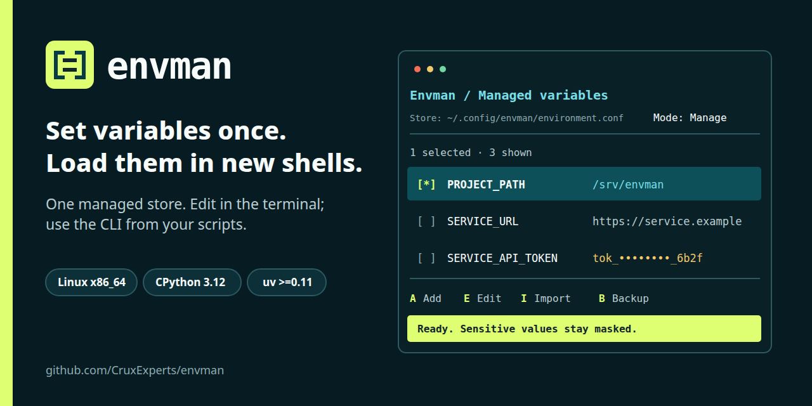
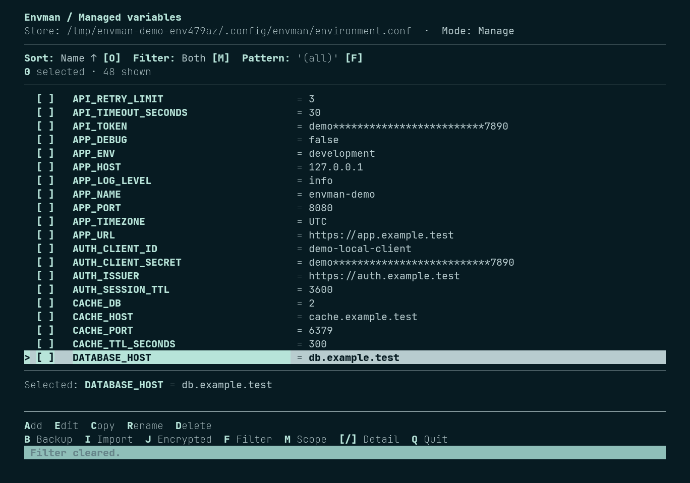

<p align="center">
  <picture>
    <source media="(max-width: 640px)" srcset="docs/assets/social-square.png">
    
  </picture>
</p>

# Envman

[](https://github.com/CruxExperts/envman/actions/workflows/ci.yml)
[](https://github.com/CruxExperts/envman/actions/workflows/codeql.yml)
[](https://github.com/CruxExperts/envman/releases/latest)
[](LICENSE)

**Source version:** 1.0.0

This is the version of this source checkout, not a publication claim. The
**Latest release** badge above and [GitHub Releases](https://github.com/CruxExperts/envman/releases/latest)
identify the published version installed by the commands below. Source changes
awaiting publication are listed under [Unreleased](CHANGELOG.md#unreleased).

Keep per-user environment variables in one managed store. Browse and edit them in a focused terminal catalog, or use the CLI from scripts. Generated shell loaders keep startup files readable.

**Linux x86_64** · **CPython 3.12** · **uv >=0.11** · **Terminal UI + CLI**

> [!IMPORTANT]
> The verified release installer currently supports Linux x86_64, CPython `>=3.12,<3.13`, and `uv >=0.11`.

## Install and open Envman

Before installing, the release installer checks immutable asset URLs, sizes, hashes, wheel metadata, runtime requirements, and host compatibility.

```bash
uv run --python 3.12 --script \
  https://github.com/CruxExperts/envman/releases/latest/download/install.py

export PATH="$(uv tool dir --bin):$PATH"
envman
```

A new store starts empty. Press `A` to add a variable. Press `Q` or `Esc` to leave the catalog and start a child shell with the managed environment.

<picture>
  <source media="(prefers-reduced-motion: reduce)" srcset="docs/assets/terminal-preview.png">
  <source type="image/webp" srcset="docs/assets/terminal-walkthrough.webp">
  
</picture>

Recorded from the actual app in WezTerm with 48 realistic demonstration variables and a brand-matched terminal palette. The interface is not generated or reconstructed. Credentials are fake and remain masked. [Open the full-size walkthrough](docs/assets/terminal-walkthrough.webp) or [view the still screenshot](docs/assets/terminal-preview.png).

## A small set of useful guarantees

- The terminal UI and CLI share the same validation, masking, and save behavior.
- Sensitive names and password-bearing URLs stay masked unless a trusted caller explicitly asks to reveal them.
- Process and backup imports show proposed changes first; `--apply` is required to write them.
- New saves encrypt the managed configuration with a separate private storage key. Encrypted exports use an independent backup credential.
- Updates stay tied to the trusted provider recorded in the private installation receipt.

Envman is a local operator tool. It does not provide hosted sync, team access control, or remote secret storage, and it does not replace an operating-system credential store.

## Use the interface that fits the job

| Terminal UI | Scriptable CLI |
| --- | --- |
| `Up` and `Down` move focus. `Space` builds a selection. | `envman list --json` returns stable machine-readable output. |
| `A`, `Enter`, and `R` add, edit, and rename. | `set`, `unset`, and `rename` make explicit changes. |
| `I` and `J` preview process or encrypted-backup imports. | Import commands preview first and require `--apply` to save. |
| `B` backs up selected variables, or the full set when none are selected. | `export` writes an authenticated encrypted JSON backup. |

Common CLI commands:

```bash
envman set PROJECT_URL --value https://example.test
envman get PROJECT_URL
envman list --json
envman validate API_TOKEN --stdin
envman check --json
```

Use `--stdin` for values that should not appear in shell history. Use `envman --nocolor` when the terminal cannot use curses color pairs.

## Storage and masking

Envman stores assignments under `${XDG_CONFIG_HOME:-$HOME/.config}/envman/`. The first save creates a separate random storage key under `${XDG_STATE_HOME:-$HOME/.local/state}/envman/storage.key` and encrypts the managed configuration. Automatic environment snapshots created after that save contain ciphertext.

Anyone who obtains both the storage key and encrypted file can recover the values. The optional [local key service](docs/guides/local-key-service.md) separates keys from user homes through one-time administrator provisioning and explicit migration. Code acting as the enrolled user, root, service-account compromise, hypervisor access, and full VM snapshots remain outside its protection. The [storage and shell-loading reference](docs/reference/storage-and-shell-loading.md) documents the full boundary and plaintext-snapshot migration.

The local key service is experimental and requires separate administrator provisioning and migration. Its systemd startup, SSH, and reboot behavior have not yet been qualified on an isolated deployment.

Encrypted backup files use `ENVMAN_BACKUP_KEY` when it is configured. Otherwise Envman can use a private fallback key, but only after explicit approval:

```bash
envman key --generate --approve-key-generation
envman export backup.json
envman import-backup backup.json --all --apply
```

The command never prints key material. `--yes` and `--force` do not approve key generation. Keep keys, managed values, receipts, and backup files out of source control.

<details>
<summary>Install the optional agent skill</summary>

Releases that include the Envman agent skill can install it globally or for a repository. Automatic placement uses the shared `.agents/skills` root and also refreshes existing LocalSetup-supported native roots:

```bash
uv run --python 3.12 --script \
  https://github.com/CruxExperts/envman/releases/latest/download/install.py \
  --install-skill --skill-scope global

uv run --python 3.12 --script \
  https://github.com/CruxExperts/envman/releases/latest/download/install.py \
  --install-skill --skill-scope repository --skill-target opencode
```

Use `--skill-target all` for every LocalSetup 4.49.2 write shape, or repeat `--skill-target AGENT` for selected agents. The installed updater can refresh the skill from Envman's latest verified GitHub release even when the tool version is already current:

```bash
envman update --install-skill --skill-scope global --skill-target codex
```

The installer refuses symlink escapes and preserves an unmarked existing skill. See the [installation guide](docs/getting-started/installation.md) for all 20 target names and recognized roots.

</details>

## Documentation

- [Install and update Envman](docs/getting-started/installation.md)
- [Use the terminal UI](docs/guides/tui.md)
- [Automate with the CLI](docs/guides/cli.md)
- [Create and restore encrypted backups](docs/guides/backups-and-migration.md)
- [Understand storage and shell loading](docs/reference/storage-and-shell-loading.md)
- [Inspect the release and update trust boundary](docs/reference/install-source-and-updates.md)
- [Read the architecture](docs/development/architecture.md)
- [Run the test suite](docs/development/testing.md)
- [Review copyright and signing policy](docs/governance/repository-policy.md)

## Support and contributions

Ask usage questions in [GitHub Discussions](https://github.com/CruxExperts/envman/discussions). Report reproducible defects in [GitHub Issues](https://github.com/CruxExperts/envman/issues). Suspected vulnerabilities belong in [private vulnerability reporting](https://github.com/CruxExperts/envman/security/advisories/new), never a public issue.

Contributors should read [CONTRIBUTING.md](CONTRIBUTING.md), [SECURITY.md](SECURITY.md), and the [Code of conduct](CODE_OF_CONDUCT.md).

## License and copyright

Copyright (c) 2026 [Crux Experts LLC](https://www.cruxexperts.com/).
Envman source code and documentation are released under the [MIT License](LICENSE).
Original visual assets remain private and retain their own embedded rights
notices; third-party notices remain unchanged. See the
[repository policy](docs/governance/repository-policy.md) for ownership and
verified RSA OpenPGP publication requirements.
